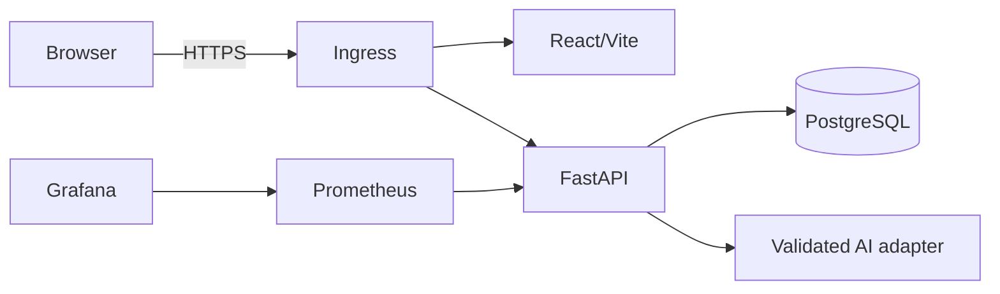

# Halcer AI-First Idea Board Platform

This directory is an additive implementation next to the repository's original
inventory pipeline. It provides a small, runnable idea board and production
deployment scaffolding without pretending that AWS and GCP have identical
resources.

## Architecture



The browser uses React/Vite. FastAPI owns validation, persistence and the
structured AI safety boundary. SQLAlchemy targets PostgreSQL in deployments;
SQLite is the default for quick local API tests. AI output is parsed through
Pydantic bounds and is never executed as Terraform or shell code.

## Local run

```bash
cd platform
copy .env.example .env
# Replace POSTGRES_PASSWORD with a local-only password.
docker compose up --build
```

Open `http://localhost:5173`; Swagger is at `http://localhost:8000/docs`.
For a dependency-managed development run, install `backend/requirements.txt`
and start `uvicorn app.main:app --app-dir backend --reload`. In another shell:

```bash
cd frontend
npm ci
npm run dev
```

Vite proxies `/api` to the backend.

## Environment variables

| Variable | Default | Purpose |
|---|---|---|
| `POSTGRES_PASSWORD` | required by Compose | PostgreSQL and backend database password |
| `DATABASE_URL` | SQLite file outside Compose | SQLAlchemy PostgreSQL/SQLite connection URL |
| `CORS_ORIGINS` | `http://localhost:5173` | Comma-separated exact browser origins |
| `AI_PROVIDER` | `deterministic` | Use `deterministic` or `openai_compatible` |
| `AI_BASE_URL` | `https://api.openai.com/v1` | OpenAI-compatible API base URL |
| `AI_MODEL` | `configured-model` | Model identifier sent to the provider |
| `AI_API_KEY` | empty | Provider credential; never commit a real value |
| `AI_TIMEOUT_SECONDS` | `20` | Provider HTTP timeout, bounded from greater than zero to 120 |

Copy `.env.example` for local Compose use and replace all placeholders. Real
LLM keys should come from a secret manager or CI environment secret, not the
repository or `.env` file.

## API

* `GET /health` checks the database connection.
* `GET /api/ideas` lists ideas newest first.
* `POST /api/ideas` accepts `{"content":"..."}`.
* `POST /api/ai/infrastructure-config` returns bounded environment, resource,
  replica and autoscaling JSON.
* `POST /api/ai/deployment-analysis` summarizes logs and pod status.

The AI adapter is deterministic by default. Set `AI_PROVIDER=openai_compatible`,
`AI_BASE_URL`, `AI_MODEL`, and `AI_API_KEY` to use an OpenAI-compatible
chat-completions provider. Requests redact common credentials, use a timeout,
request JSON output, and validate the response with Pydantic. Provider failures
return an explicit 502; they never silently fall back to deterministic output.
Do not send unredacted secrets or sensitive production logs to an external
provider.

## Kubernetes

Create `idea-board-secrets` from `kubernetes/secret.example.yaml` using an
external secret manager or sealed secret; never commit actual credentials.
Apply `namespace.yaml`, `configmap.yaml`, a secret created by an external
secret manager, and `kustomization.yaml`. The kustomization intentionally
excludes `secret.example.yaml`. Replace example image names and the ingress
host. Readiness/liveness failures are the only trigger for an automated
rollback; AI only explains failures. Metrics-server, an ingress controller,
DNS, TLS, and a reachable managed PostgreSQL database remain prerequisites.

Render and review the manifests locally with:

```powershell
kubectl kustomize platform/kubernetes
```

Apply only after configuring an approved cluster, external Secret, registry
image names, DNS, TLS and database connectivity.

## Terraform

`terraform/modules/aws` defines VPC subnets/routes, ECR, IAM, EKS, security
groups, and encrypted private RDS resources. The GCP module defines VPC,
secondary ranges, Artifact Registry, service account, firewall, GKE, and
private Cloud SQL resources. EKS/GKE/RDS/Cloud SQL are conditional and
`enable_expensive_resources` defaults to false. Supply a sensitive database
password only when enabling those resources. Run `terraform fmt -check`,
`terraform init`, `terraform validate`, and `terraform plan` in the selected
environment after setting provider credentials. Configure remote state
(S3+DynamoDB for AWS or GCS for GCP) in your organization rather than
committing backend credentials. These modules have not been applied here.

## CI/CD and preview commands

`.github/workflows/deploy.yml` runs backend/frontend tests, builds and scans
both images, renders Kubernetes manifests, and can publish immutable SHA tags
when `PUBLISH_IMAGES=true`. Production deployment is disabled unless
`DEPLOY_ENABLED=true`, and requires cloud OIDC, a kubeconfig, managed database,
registry, ingress, and `HEALTH_URL`. The deployment job only rolls back after
deterministic rollout/health failure. `/deploy-preview` validates write
permission, checks out the PR head, generates bounded configuration, and
reports that deployment is disabled until preview infrastructure is configured;
it deliberately does not execute arbitrary comment text.

## Monitoring and security

Prometheus can scrape `/metrics`; `monitoring/grafana-dashboard.json` is a
starter dashboard. The current endpoint exposes an availability gauge rather
than full request/database metrics. Use TLS at the ingress, external secret
management, short-lived OIDC cloud credentials, least-privilege service
accounts, image scanning, network policies, and managed PostgreSQL in
production.

## Tests

```bash
cd platform/backend
pytest -q
```

The checked-in tests cover health, list/create validation and both structured AI
features. Frontend production build and cloud provisioning require Node,
Docker, provider credentials, and/or a cluster and are intentionally not
claimed as executed here.
